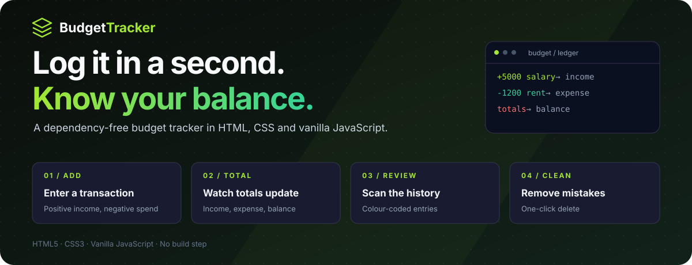
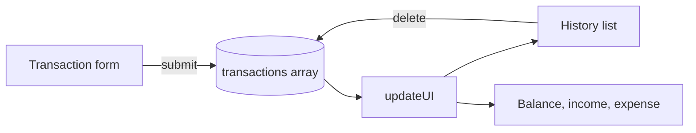

<p align="center">
  
</p>

<p align="center">
  <strong>A fast, dependency-free budget tracker.</strong><br />
  Log income and expenses in one form and watch your balance, income and spending update instantly.
</p>

<p align="center">
  
  
  
  
</p>

<p align="center">
  <a href="#the-product">Product</a> ·
  <a href="#engineering-decisions">Engineering</a> ·
  <a href="#architecture">Architecture</a> ·
  <a href="#run-locally">Run locally</a> ·
  <a href="#creator">Creator</a>
</p>

---

## The product

Most budgeting apps ask for an account, categories and a setup wizard before you can log a single expense, so people stop using them.

**Budget Tracker does one thing quickly: add a transaction and see where you stand.** Positive amounts are income, negative amounts are expenses, and the totals update the moment you press **Add**. It runs straight from `index.html` with no installation.

| Capability | What you can do |
| :--- | :--- |
| **One-form entry** | Add a description and an amount: `+` for income, `-` for an expense. |
| **Live totals** | Balance, total income and total expenses (in ₹) recalculate after every change. |
| **Transaction history** | Every entry is listed with its amount; expenses are highlighted. |
| **Quick correction** | Remove any transaction with its delete button and the totals update instantly. |
| **Input validation** | Empty descriptions, non-numeric values and zero amounts are ignored. |
| **Responsive design** | A dark, neon-green interface that works on desktop and mobile. |

### A workflow you can follow

**Enter "Salary, 5000" → enter "Rent, -1200" → balance shows ₹3,800 → delete a mistake → totals adjust**

## Engineering decisions

| Engineering problem | Implementation | Inspect the code |
| :--- | :--- | :--- |
| Totals must never disagree with the list | One `updateUI()` pass rebuilds the list and recomputes income, expense and balance from the same array. | [`script.js`](script.js) |
| Separate income and expense forms slow people down | The sign of the amount decides the type, so one form handles both. | [`script.js`](script.js) |
| Small projects don't need a framework | Plain DOM APIs, one stylesheet and no build step keep the app instant to load and easy to read. | [`index.html`](index.html), [`style.css`](style.css) |

## Architecture



<details>
<summary><strong>Scope and known limitations</strong></summary>

- Transactions live in memory only and are cleared when the page is reloaded.
- Some income and expense labels in the history still show `$` instead of `₹`.
- There are no categories, budgets or charts yet.

</details>

## Run locally

```bash
git clone https://github.com/Lingu17/Buget-tracker-app.git
cd Buget-tracker-app
```

Open `index.html` in any modern browser. No server or installation is needed.

To serve it locally instead:

```bash
python -m http.server 8000
```

Then open [http://localhost:8000](http://localhost:8000).

## Project map

```text
Buget-tracker-app/
├── index.html   Layout: balance, summary, form, history
├── style.css    Dark neon-green theme and responsive layout
└── script.js    Transactions, totals, delete and validation
```

## Creator

**Lingraj Malipatil** · [GitHub @Lingu17](https://github.com/Lingu17) · [LinkedIn](https://www.linkedin.com/in/lingraj-malipatil-a2735a241/)

---

<p align="center"><strong>Budget Tracker</strong><br />Log it in a second. Know your balance.</p>
